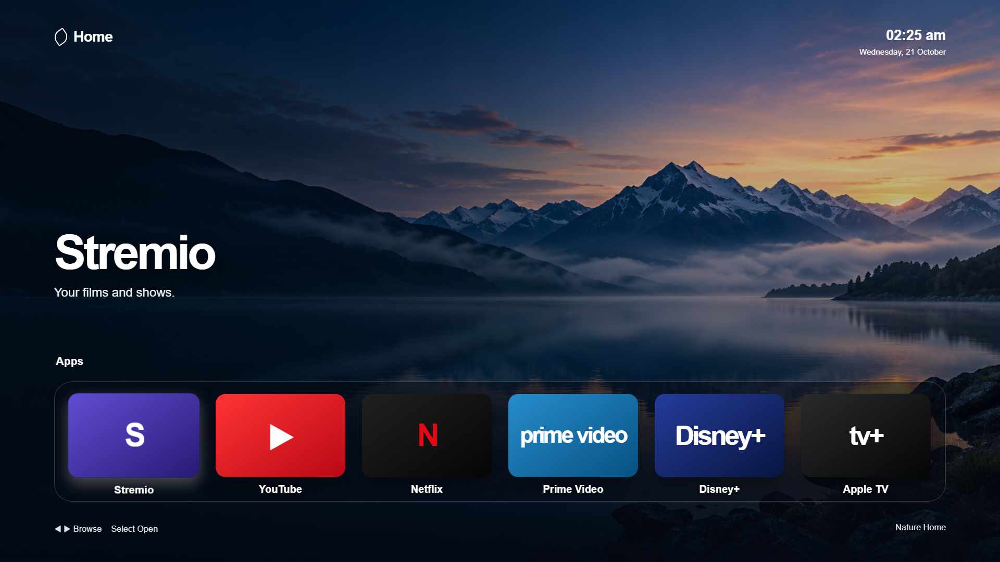

# SamDock

SamDock contains Nature Home, a separate app launcher for Samsung Tizen 6.0 TVs. It shows a clock, rotating local wallpapers, and six app tiles. On a TV, it looks up installed apps by name and launches a match. It does not replace Samsung Home or change the remote's Home button.

The project is plain HTML, CSS, and JavaScript. It has no npm package or build script, and the app makes no runtime network request. The local workflow is in [How to develop and test Nature Home](docs/development.md). The proposed work is in [Next development steps](docs/next-steps.md). Project instructions for Claude are in [CLAUDE.md](CLAUDE.md).

## Project files

| Path | Role |
| --- | --- |
| `src/index.html` | Current UI, styles, app lookup, remote keys, clock, and wallpaper rotation. Edit this file for app behavior. |
| `src/config.xml` | Tizen app identity, TV profile, minimum version, and app privileges. |
| `src/wallpaper-*.png`, `src/icon.png` | Local image assets used by the app and package. |
| `src/selfcheck.js` | Node check for three app-name lookup cases. |
| `src/app-check.js` | Unused copy of the inline app script. `index.html` does not load it. |
| `preview/` | Copy of the app files for preview. Its `index.html` currently matches `src/index.html`. |
| `development/` | Earlier packaging attempts, signed staging directories, TV discovery output, and an SDB bundle. These are records, not the current source. |
| `NatureHome.wgt` | Signed package snapshot. Its `index.html` matches `src/index.html` at this handoff. Rebuild it after app changes. |
| `Nature-Home-source.zip` | Source archive snapshot. Its files match `src/` at this handoff. Recreate it after source changes. |

## Current behavior

The tiles are Stremio, YouTube, Netflix, Prime Video, Disney+, and Apple TV. `favorites` in `src/index.html` defines their labels and app-name matches. On a TV, `tizen.application.getAppsInfo` supplies installed apps, and `tizen.application.launch` opens the matched app. A missing app shows a notice instead. Name matching tries an exact lowercase name first, then a substring match, so ambiguous installed names can select the wrong app.

Left and right arrows move focus through the dock. Enter opens the focused tile. The clock updates every 10 seconds, and the three wallpapers rotate every minute. In a desktop browser, tiles show a preview notice because the Tizen API is unavailable.

`src/config.xml` declares the Samsung TV profile, Tizen 6.0 requirement, and privileges for reading app information and launching apps. The app has no code that modifies installed apps. TV app discovery and launch require a signed install on a compatible TV; the desktop preview cannot verify them.

## Known limits

- `src/selfcheck.js` tests app-name lookup only. It does not test rendering, remote input, packaging, or TV launch.
- There is no automated package or deployment command in this workspace. The existing WGT and staged signatures are snapshots.
